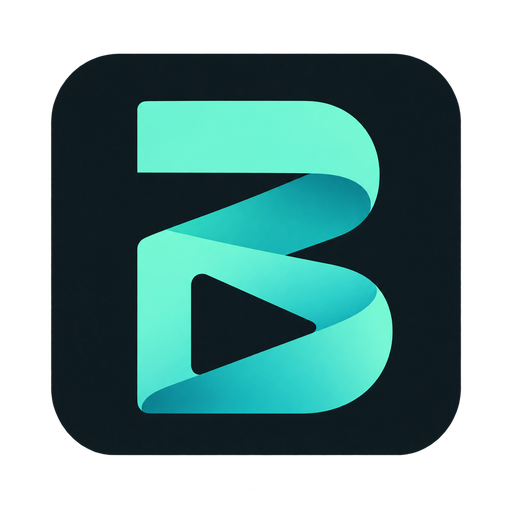

# Beta Render



Ứng dụng Windows xuất video hàng loạt bằng GPU. Luồng chính: **thêm video → chọn preset → Xuất video**. App nhớ preset và nơi lưu; có thể xuất một file hoặc chia thành nhiều part, nguồn được giữ nguyên.

Mã nguồn [công khai GPL-3.0-only](https://github.com/x1-2023/template-studio). Dự án độc lập; xem [giấy phép thành phần](THIRD_PARTY_NOTICES.md).

[Logo gốc và các định dạng sử dụng trong ứng dụng](docs/brand/README.md).

## Dùng EXE

1. Tải `TemplateStudio-windows-x64.zip` trong [GitHub Releases](https://github.com/x1-2023/template-studio/releases/latest), giải nén toàn bộ rồi chạy `TemplateStudio.exe`. Tên file được giữ để tương thích updater; tên ứng dụng là **Beta Render**.
2. Lần đầu app kiểm tra GPU/FFmpeg. Nếu thiếu FFmpeg, app tự tải runtime Gyan đã xác minh SHA256; cần mạng cho lần chuẩn bị này, sau đó dùng offline. Cần Windows 10/11 x64 và driver OpenGL 3.3 trở lên.
3. Hiệu ứng ngũ giác và bộ lọc Camera đã có sẵn trong gói app, không cần cài CapCut hay nhập RAR/cache thủ công. Gói chỉ chứa 22 shader/LUT/texture renderer sử dụng, có manifest SHA256; không kèm video, project hoặc dữ liệu người dùng. Mục nhập hiệu ứng trong **Cài đặt** được giữ như tùy chọn nâng cao.
4. Thêm video hoặc thư mục, chọn mẫu, bấm **Xuất video**. Có thể xem thử trước bằng **Xem thử 3 giây**. **Chọn thư mục** để chọn thư mục xuất.

Nếu máy báo thiếu `ffprobe`/`ffmpeg`, bản 1.3.4 kiểm tra và sửa bộ công cụ trước khi đọc video. Lỗi tải runtime hiện ngay ở màn hình chính, không bị thông báo GPU che đi; bấm **Thử lại FFmpeg** khi mạng đã có lại. Sau khi tải thành công, app giữ ZIP đã xác minh trong `cache/` để sửa lại công cụ bị thiếu/hỏng khi offline. Có thể tải [ZIP FFmpeg 7.1.1 essentials của Gyan](https://github.com/GyanD/codexffmpeg/releases/download/7.1.1/ffmpeg-7.1.1-essentials_build.zip) trên máy khác rồi vào **Cài đặt → Cài từ ZIP FFmpeg đã tải…**; app vẫn kiểm tra SHA-256. Các video bản cũ đánh dấu lỗi thiếu công cụ được đọc lại và đưa về hàng chờ sau khi sửa runtime, giữ preset đã chọn. Không cần cài FFmpeg vào PATH.

## Preset và cấu hình

- Ba preset TikTok xuất **video dọc 9:16, 1080 × 1920, 30 FPS**, MP4/H.264 và âm thanh AAC. [TikTok khuyến nghị video dọc 9:16 và xuất 1080 × 1920](https://ads.tiktok.com/business/en/guides/video-advertising-guide).
- Mặc định **TikTok · Ngũ giác + Camera** bật đồng thời **Lớp phủ ngũ giác lấp lánh** (`7491138615477685505`) và **Camera độ nét cao 2** (`7514206177195068689`), tốc độ 1×, không lật ngang. Một preset lưu chung hiệu ứng, bộ lọc, bố cục và thiết lập xuất.
- **TikTok · Chỉ bộ lọc Camera** tắt hiệu ứng mở đầu; **TikTok · Chỉ nền mờ** tắt cả hiệu ứng và bộ lọc. Cả ba đều dùng 9:16. Preset tự lưu vẫn được giữ.
- **1012 · Karaoke đỏ + video nghiêng** xuất 3:4, 1080 × 1440/30 FPS, khoảng 9.65 Mb/s, video nghiêng −9°, chữ nghiêng −11°, từ đang đọc màu đỏ. Mặc định tự nhận lời thoại từ MP4, lấy tên file làm tiêu đề và **tự chia khoảng 180 giây/part**, ưu tiên khoảng nghỉ lời thoại gần mốc cắt. Mỗi phần có intro và nhãn PART riêng. Tốc độ 1.0293× theo Draft mẫu. Trong **Chỉnh cấu hình** có thể đổi thời lượng, số part, màu chữ, góc, tiêu đề hoặc nguồn phụ đề.
- Profile Tiêu chuẩn TikTok dùng H.264 VBR 12 Mb/s; Tiết kiệm dùng 60% bitrate đã chọn; Chất lượng cao dùng CQ18, dung lượng tùy nội dung.
- **Cài đặt → Dùng cấu hình video mẫu 3:4** mở cấu hình đối chiếu riêng: 1080 × 1440, lật ngang, 1.02× và 9.65 Mb/s theo cặp nguồn–CapCut. Mẫu này được giữ để kiểm tra kết quả, không nằm trong danh sách TikTok chính. Bố cục 9:16 dựa trên draft, chưa có cặp video draft gốc để chấm độ giống.
- Giao diện gồm **Nguồn video → Cấu hình chung → Xem trước**. Bấm **Chỉnh cấu hình…** để mở cửa sổ lớn với các nhóm thu gọn; chỉnh bằng thanh kéo hoặc nhập số. **Lưu thay đổi** áp dụng cho video chưa xuất; **Hủy** bỏ lần chỉnh đó. Preview nằm bên phải; lưu preset và nhập/xuất JSON ngay trong cột cấu hình.
- Shader chạy GPU; NVENC tăng tốc mã hóa. Chọn mã hóa CPU vẫn cần OpenGL cho shader.

Preview và xuất dùng cùng engine. Preview 540px giúp xem nhanh; chất lượng ở kích thước full có thể khác do nội suy và sharpen phụ thuộc kích thước. Xem [báo cáo port GPU](CapCut_FFmpeg_Codex_Handoff/work/REPORT.md) và [đối chiếu dung lượng](CapCut_FFmpeg_Codex_Handoff/work/ENCODING_REPORT.md). Không tuyên bố tái tạo CapCut 1:1; chưa có model segmentation/stabilization/HDR gốc.

## Karaoke tự động

Chọn preset **1012**, thêm MP4 và bấm **Xem thử** hoặc **Xuất video**. Lần đầu dùng, app tải bộ Whisper native và model đa ngôn ngữ Base khoảng 150 MB, kiểm tra SHA256 rồi lưu trong `data/template-studio/runtime/speech/`. Sau đó nhận lời thoại offline trên CPU, trong worker riêng; shader video và mã hóa NVENC vẫn dùng GPU khi có. Không cần Python, CUDA hay cài CapCut. Video không được tải lên dịch vụ nhận giọng nói.

Phụ đề được nhận một lần cho mỗi nguồn và lưu trong `cache/captions/`; preview, các part và các lượt xuất lại dùng chung. Nguồn thay đổi sẽ được nhận lại. Whisper tự nhận ngôn ngữ, giữ lời gốc; độ chính xác phụ thuộc âm thanh. Kiểm tra bằng bản xem thử. Video không có âm thanh cần tắt phụ đề hoặc chọn file có sẵn.

Có thể chọn `video.words.json`/`video.srt` cạnh video hoặc dùng **Chọn file…**. JSON nhận danh sách `{text,start,end}` tính bằng giây, hoặc `draft_content.json` của CapCut. Với Draft dựng từ một video gốc, app quy đổi lời và mốc từng từ về thời gian nguồn trước khi chia part/đổi tốc độ; giữ các từ nhiều tiếng như “New York” và ranh giới câu. Draft dựng nhiều nguồn, đảo chiều hoặc tốc độ biến thiên cần chuyển sang SRT/JSON từng từ. Chỉ những đoạn có phụ đề trong Draft mới có chữ; muốn nhận toàn bộ nguồn hãy dùng **Tự nhận lời thoại**. SRT ước lượng thời gian từng từ từ mốc cả dòng.

Chế độ tự chia dùng thời lượng sau khi đổi tốc độ/cắt đầu. App tìm khoảng nghỉ hoặc cuối câu trong ±8 giây quanh mốc, dịch điểm cắt ra cuối từ nếu cần, gộp đuôi ngắn và giữ toàn bộ nội dung còn lại. Khi tắt phụ đề, app chia theo thời lượng. Điểm cắt được làm tròn theo khung hình; đây là quy tắc tự động, có thể khác cắt thủ công trong Draft. Sổ tiến độ trong `cache/parts/` giữ đường dẫn và trạng thái từng phần. Khi dừng/lỗi, phần đã hoàn tất được giữ; chạy lại cùng nguồn, cấu hình và nơi xuất sẽ kiểm tra codec, kích thước, FPS, thời lượng và âm thanh rồi tiếp tục phần thiếu. Đổi cấu hình tạo một lượt xuất mới; file đang có không bị ghi đè.

Tiêu đề dùng `{video}` để lấy tên file, có thể sửa thành nội dung riêng hoặc để trống để tắt. Từ **1.3.6**, preset 1012 dùng **ZY Trend có sẵn trong app** cho phụ đề, tiêu đề và PART, với cỡ chữ theo mẫu đã đối chiếu. Máy khác giải nén gói app là có font; không cần nhập file hoặc cài font vào Windows. Cấu hình 1012 cũ còn dùng font mặc định Arial Black được chuyển sang ZY Trend; font riêng đã chọn được giữ. Nút **ZY Trend** trong nhóm phụ đề đưa về font có sẵn. **Chọn font…** vẫn cho nhập TTF/OTF/TTC khác vào `runtime/fonts/` và giữ qua updater. Gói app không kèm cache template chữ của CapCut.

Preset 1012 có **Nhấn màu từ khóa** và **Emoji theo từ khóa**, tắt riêng được. Đây là quy tắc từ khóa tiếng Anh/Việt và ảnh Twemoji được dựng lại, không phải bộ template CapCut gốc. Thông tin tác giả/giấy phép emoji nằm trong thông báo thành phần và metadata `comment` của MP4. Giữ thông tin ghi công phù hợp khi phân phối video có các biểu tượng này. Intro ngũ giác mặc định chạy ở đầu mỗi part; có thể chỉnh lặp. **Thiết lập video → Độ trễ âm thanh** cho phép bù ±1000 ms; mẫu 1012 dùng +50 ms theo đối chiếu hai clip, các mẫu khác giữ 0 ms. Preview giữa part dùng cùng mốc, không chèn lại độ trễ ở đầu preview.

Trong **Chỉnh cấu hình → Thiết lập đầu ra → Chia video**, chọn **Chọn số part** rồi nhập 2–100 để chia đều toàn bộ nguồn thành đúng số phần đó. Vẫn có chế độ xuất một video hoặc tự chia theo số giây. Mục **Phụ đề karaoke** có màu riêng cho chữ phụ đề, từ đang đọc, viền, chữ tiêu đề, nền tiêu đề, chữ PART và nền PART. Mỗi mục có 10 màu cơ bản để bấm nhanh, bảng chọn màu tùy ý và ô HEX. Các màu được lưu cùng preset, dùng cho preview và bản xuất. Preset cũ giữ màu PART giống tiêu đề cho tới khi bạn chỉnh riêng. Danh sách video đã xuất có combobox chọn part để mở, kể cả khi xuất nhiều phần.

## Hàng đợi và dữ liệu

Nhập tối đa 200 video; chạy một job/lần, hiện tiến độ và ETA. Một nguồn lỗi không chặn các file tiếp theo. Tick checkbox để chạy nhóm chọn. **Bỏ khỏi danh sách** chỉ bỏ khỏi danh sách; **Ẩn video đã xuất** giữ nguyên file trên đĩa. **Xuất lại** đặt mục lỗi về hàng chờ; khi có checkbox chọn thì đặt các mục chọn về hàng chờ để xuất lại theo cấu hình hiện tại.

**Dừng sau video này** hoàn tất video hiện tại; **Dừng** hủy worker/FFmpeg và dọn partial của tác vụ. Mở lại app tiếp tục ở cấp file, không nối từ frame đang dở. Cấu hình của file đã hoàn tất được giữ khi đổi preset cho file đang chờ.

Thư mục xuất chỉ nhận MP4. Log và thống kê của mỗi video nằm trong `data/template-studio/cache/workers/<mã tác vụ>/`; báo cáo lượt chạy JSON/CSV nằm trong `cache/workers/batches/`. Chọn video bị lỗi rồi bấm **Nhật ký lỗi** để mở log; **Cài đặt → Mở nhật ký** mở toàn bộ. Khi khởi động, app cất các log/báo cáo cũ đã nhận diện sang `cache/workers/archived-exports/`, giữ nguyên video và file không thuộc app. File đang khóa được giữ lại để thử ở lần mở sau.

`production.json` lưu preset, cấu hình và hàng đợi mới; `session.json` của GUI cũ được giữ và sao lưu khi nhập sang giao diện mới. Dữ liệu mặc định trong `data/template-studio/` cạnh EXE; nếu không ghi được thì dùng `%LOCALAPPDATA%/TemplateStudio`. Có thể đặt `TEMPLATE_STUDIO_HOME`. Tài nguyên mặc định nằm trong `template_studio/assets/effects/` của gói app; cache tùy chọn của người dùng nằm trong `runtime/capcut-cache/` của thư mục dữ liệu. `TEMPLATE_STUDIO_CAPCUT_CACHE` cho phép chỉ định cache riêng.

Lần đầu dùng bản mặc định TikTok, cấu hình hiện tại và video chưa xuất được chuyển sang khung 9:16, giữ các thông số hiệu ứng, âm thanh, tốc độ và vị trí đã chỉnh. `production-before-tiktok.json` giữ bản sao trước khi chuyển. Cấu hình của video hoàn tất và các preset tự lưu không bị ghi đè. Cấu hình đối chiếu 3:4 được chọn sau đó vẫn giữ qua các lần mở app.

GUI thư viện Video-FX cũ vẫn mở được từ source bằng `python template_gui.py --library`; không ghép 150 filter CPU vào chuỗi GPU mới trong phiên bản này.

Khi nâng từ 1.2.1, app sao lưu `production.json` thành `production-before-karaoke.json`, rồi bổ sung các trường mới cho hàng chờ. Thông số cũ được giữ; các video cũ vẫn xuất một file và tắt karaoke cho tới khi bạn chọn preset mới. Bản sao trước chuyển đổi được giữ trong thư mục dữ liệu để phục hồi khi cần.

## Updater

App tự kiểm tra GitHub Releases khi mở và mỗi 4 giờ. Nếu đang tải FFmpeg hoặc xuất video, việc kiểm tra được chờ tới lúc rảnh. Có bản mới sẽ hiện **Cập nhật app** ở màn hình chính; bấm để app tải, xác minh SHA256 và tự cài/mở lại. Cũng có thể kiểm tra thủ công trong **Cài đặt**. Giữ preset, queue, cache riêng, runtime và video xuất. Helper giữ backup và phục hồi nếu bản mới không khởi động được; nhật ký nằm trong `.updates/` cạnh EXE. Tài nguyên mặc định được cập nhật cùng app.

EXE chưa ký Authenticode. SHA256 xác minh toàn vẹn gói tải xuống; nguồn phát hành cố định trong `template_studio/version.py`.

## Chạy source, kiểm thử và build

```powershell
py -3.14 -m venv .runtime/dev
.runtime/dev/Scripts/python.exe -m pip install -r requirements-lock.txt
.runtime/dev/Scripts/python.exe template_gui.py
```

Hoặc dùng `run_template.bat`; launcher chuẩn bị các dependency còn thiếu. Bản build được kiểm thử bằng Python 3.14 x64.

```powershell
$env:PYTHONUTF8 = '1'
.runtime/dev/Scripts/python.exe -m ruff check template_studio template_gui.py build_template.py tools tests --select F
.runtime/dev/Scripts/python.exe -m unittest discover -s tests -v
.runtime/dev/Scripts/python.exe template_gui.py --check --capture .runtime/production.png
.runtime/dev/Scripts/python.exe build_template.py
```

QA local có GPU: `python template_gui.py --check-gpu`; GUI với preview thật: `python tools/capture_production.py`. Không commit `.runtime`, dữ liệu, cache cá nhân, video hay binary FFmpeg. CI public kiểm tra GUI/preset/queue/updater, gói hiệu ứng và worker đóng gói; render GPU được kiểm định trên máy local. `tools/prepare_effect_assets.py` tái tạo gói 22 file từ cache nguồn khi cần cập nhật tài nguyên.

Đầu ra build: `release/template-studio/TemplateStudio/TemplateStudio.exe` và ZIP/checksum cạnh đó. Engine chung nằm trong `template_studio/gpu`; CLI trong `CapCut_FFmpeg_Codex_Handoff/work` là wrapper tương thích.

## Phát hành

Cập nhật `VERSION`, release notes, commit rồi đẩy tag `v<phiên bản>`. Workflow Windows kiểm tra, build, smoke test EXE/worker và public GitHub Release. Giữ tên asset `TemplateStudio-windows-x64.zip` để updater bản cũ nhận được bản mới. Không sửa asset của release đã công bố.
